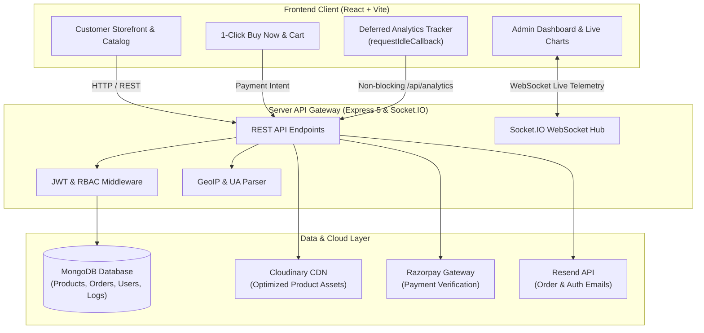

<p align="center">
  
</p>

<h1 align="center">Farbetter — Premium Protein Snacks E-Commerce</h1>

<p align="center">
  <strong>A full-stack, production-grade MERN monorepo engineered for clean-label, high-protein nutrition snacks.</strong><br />
  Featuring real-time visitor analytics, seamless Razorpay payments, 1-click Buy Now flow, and enterprise admin tooling.
</p>

<p align="center">
  <a href="https://github.com/Mayank2410990450/Farbetter/actions"></a>
  <a href="https://github.com/Mayank2410990450/Farbetter/blob/main/LICENSE"></a>
  <a href="https://react.dev/"></a>
  <a href="https://vitejs.dev/"></a>
  <a href="https://nodejs.org/"></a>
  <a href="https://expressjs.com/"></a>
  <a href="https://www.mongodb.com/"></a>
  <a href="https://socket.io/"></a>
  <a href="https://tailwindcss.com/"></a>
  <a href="https://razorpay.com/"></a>
</p>

<p align="center">
  <a href="#-key-features">Key Features</a> •
  <a href="#-system-architecture">Architecture</a> •
  <a href="#-tech-stack">Tech Stack</a> •
  <a href="#-quick-start">Quick Start</a> •
  <a href="#-monorepo-structure">Project Structure</a> •
  <a href="#-api-endpoints">API Reference</a> •
  <a href="#-real-time-analytics">Live Analytics</a> •
  <a href="#-deployment">Deployment</a> •
  <a href="#-contributing">Contributing</a>
</p>

---

<p align="center">
  
</p>

---

## 🌟 Executive Summary

**Farbetter** redefines healthy snacking with a performant, consumer-first digital storefront and a comprehensive back-office operational command center. Engineered as an organized **monorepo**, Farbetter pairs an ultra-responsive React + Vite frontend with an Express 5 and MongoDB backend, integrated with Cloudinary media management, Razorpay payment processing, and real-time Socket.IO visitor telemetry.

Whether you're shopping for **BBQ Protein Puffs**, **Salted Caramel Bars**, or managing promotional discounts and inventory in the admin dashboard, Farbetter is built for scale, speed, and conversion.

---

## 🚀 Key Features

### 🛍️ Consumer Experience (Storefront)
- **High-Performance Catalog**: Lightning-fast product catalog with real-time multi-criteria filtering, price range slider, category pills, and instant search.
- **1-Click "Buy Now" Checkout**: Bypasses the shopping cart for rapid impulse purchasing alongside a standard full checkout flow.
- **Interactive Product Details**: Nutrition facts cards, ingredient breakdown, responsive image zoom, verified customer ratings & reviews, and real-time stock counters.
- **Smart Cart & Wishlist**: Persistent cart, wishlisting, dynamic subtotal calculations, and free-shipping progression indicator.
- **Coupon & Discount Engine**: Automated voucher validation with instant flat or percentage-based checkout discounts.
- **Seamless Payments**: Secure, PCI-compliant payment experience powered by **Razorpay** (UPI, Credit/Debit cards, Net Banking, and Digital Wallets).
- **Customer Dashboard**: Track active shipments, review past orders, manage multiple shipping addresses, and edit profile details.

### 📊 Real-Time Analytics & Admin Command Center
- **Live Visitor Telemetry**: Powered by **Socket.IO** to broadcast active visitors, page navigation journeys, and live bounce rates.
- **Geo-Location & Device Parsing**: Uses `geoip-lite` and `ua-parser-js` to pinpoint city, country, and device type (desktop vs. mobile) without third-party tracking overhead.
- **Non-Blocking Ingestion**: Analytics requests are dispatched via browser `requestIdleCallback`, guaranteeing zero performance hit on customer rendering.
- **Comprehensive Catalog Management**: Add, edit, archive products, upload high-res images to Cloudinary, configure variants, and set low-stock thresholds.
- **Coupons & Campaigns**: Create promo codes, enforce expiration dates, set maximum discount limits, and track redemption metrics.
- **System Audit Logs**: Real-time server and transaction audit logs for enterprise observability.

### 🛡️ Security, SEO & Performance
- **Dynamic SEO & Structured Data**: Built with `react-helmet-async` for OpenGraph / Twitter meta cards and JSON-LD schema (Schema.org `Product` & `Organization`) for Google Rich Search Results.
- **Automated Sitemap & Robots**: Generated `sitemap.xml` and `robots.txt` ready for search engine indexing.
- **Authentication & RBAC**: Stateless JWT auth with secure HTTP cookies, bcrypt password hashing, and OAuth 2.0 (Google & GitHub).
- **Production Hardened**: Express 5 with Helmet HTTP security headers, CORS origin whitelisting, Gzip/Brotli compression, and rate limiting.

---

## 🏗️ System Architecture



---

## 💻 Tech Stack

| Category | Technology | Description |
| :--- | :--- | :--- |
| **Frontend Framework** | [React 18](https://react.dev/) + [Vite 5](https://vitejs.dev/) | Next-generation frontend tooling with instant HMR and optimized tree-shaking |
| **Styling & UI** | [Tailwind CSS 3.4](https://tailwindcss.com/) + [Radix UI](https://www.radix-ui.com/) | Accessible, unstyled primitives styled with Tailwind and Framer Motion animations |
| **State & Data Fetching** | [TanStack React Query v5](https://tanstack.com/query) | Server-state caching, automatic refetching, and background cache synchronization |
| **Form Management** | [React Hook Form](https://react-hook-form.com/) + [Zod](https://zod.dev/) | High-performance form state validation with type-safe schema validation |
| **Icons & Typography** | [Lucide React](https://lucide.dev/) | Consistent, clean icon library |
| **Backend Runtime** | [Node.js 20+](https://nodejs.org/) & [Express 5](https://expressjs.com/) | High-throughput asynchronous JavaScript runtime and REST routing |
| **Database & ODM** | [MongoDB](https://www.mongodb.com/) & [Mongoose 8](https://mongoosejs.com/) | Scalable document datastore with schema enforcement and indexing |
| **Real-Time Layer** | [Socket.IO 4.8](https://socket.io/) | Bi-directional event communication for live admin visitor counts |
| **Authentication** | [JWT](https://jwt.io/) & [Passport.js](https://www.passportjs.org/) | Bearer tokens, HTTP-only cookies, Google & GitHub OAuth 2.0 |
| **Payments** | [Razorpay](https://razorpay.com/) | India's premier payment gateway supporting UPI, Cards, and Net Banking |
| **Asset Storage** | [Cloudinary](https://cloudinary.com/) | Dynamic image transformations, WebP auto-formatting, and CDN delivery |
| **Email Service** | [Resend](https://resend.com/) | Modern transactional email delivery for order receipts and password resets |

---

## 📁 Monorepo Structure

```text
Farbetter/
├── .github/                     # GitHub templates, CI workflows & repo assets
│   ├── assets/                  # High-res logos and marketing banner
│   ├── workflows/ci.yml         # Continuous Integration verification pipeline
│   ├── ISSUE_TEMPLATE/          # Structured bug report & feature request templates
│   └── PULL_REQUEST_TEMPLATE.md # PR checklist and guidelines
├── client/                      # Frontend Application (React + Vite)
│   ├── public/                  # Favicons, logo, robots.txt, sitemap.xml
│   ├── src/
│   │   ├── api/                 # Axios API service instances & analytics reporter
│   │   ├── components/          # Reusable UI components & Radix wrappers
│   │   ├── context/             # Auth, Cart, Wishlist, Orders React contexts
│   │   ├── hooks/               # Custom reusable React hooks
│   │   ├── pages/               # Storefront pages (Home, Shop, Product, Checkout, BuyNow)
│   │   │   └── admin/           # Admin Suite (Dashboard, Products, Coupons, Analytics)
│   │   └── lib/                 # Utility functions & QueryClient configuration
│   ├── tailwind.config.js       # Tailwind CSS theme configuration
│   └── vite.config.js           # Vite build pipeline & alias configuration
├── server/                      # Backend REST API & WebSocket Server
│   ├── config/                  # Database, Passport, & Cloudinary configurations
│   ├── controller/              # Request handlers & domain business logic
│   ├── middlewares/             # Auth, RBAC, error handlers & multer uploads
│   ├── models/                  # Mongoose schemas (User, Product, Order, Coupon, Log)
│   ├── routes/                  # Modular route declarations
│   ├── services/                # Email, GeoIP, & payment helper services
│   ├── seed.js                  # Database seeder with sample protein snacks
│   └── Server.js                # Express app initialization & Socket.IO mounting
├── .env.example                 # Root environment template
├── CONTRIBUTING.md              # Contributor guidelines
├── CODE_OF_CONDUCT.md          # Community conduct standards
├── LICENSE                      # MIT Open Source License
└── package.json                 # Monorepo scripts (concurrent execution)
```

---

## ⚡ Quick Start

### 📋 Prerequisites
Make sure you have the following installed on your machine:
- **Node.js** (v18.0.0 or higher) — [Download Node.js](https://nodejs.org/)
- **npm** (v9.0.0 or higher) or **pnpm** / **yarn**
- **MongoDB** running locally (`mongodb://localhost:27017`) or a [MongoDB Atlas](https://www.mongodb.com/atlas) cloud URI.

---

### 1️⃣ Clone the Repository
```bash
git clone https://github.com/Mayank2410990450/Farbetter.git
cd Farbetter
```

### 2️⃣ Install Dependencies
Install dependencies across both `client` and `server` with one command:
```bash
npm run install:all
```

### 3️⃣ Setup Environment Variables
Configure your `.env` files for both frontend and backend. You can copy the provided example templates:

```bash
# Setup backend environment
cp server/.env.example server/.env

# Setup frontend environment
cp client/.env.example client/.env
```

> 💡 **Tip**: For quick local development, the default values in `server/.env.example` and `client/.env.example` work out-of-the-box with a local MongoDB instance.

### 4️⃣ Seed the Database
Populate your database with initial product categories and test protein snack products:
```bash
cd server
npm run seed
cd ..
```
*You will see sample products inserted: BBQ Protein Puffs, Salted Caramel Protein Bars, Double Chocolate Cookies, and more!*

### 5️⃣ Launch Development Server
Run both client and backend concurrently with colored log prefixes:
```bash
npm run dev
```

Your services are now running at:
- 🌐 **Storefront**: [http://localhost:5173](http://localhost:5173)
- 🔌 **Backend API**: [http://localhost:5000](http://localhost:5000)
- 📊 **Admin Portal**: [http://localhost:5173/admin](http://localhost:5173/admin)

---

## 🔐 Environment Configuration

### Backend (`server/.env`)
| Variable | Description | Default / Example |
| :--- | :--- | :--- |
| `PORT` | Backend server port | `5000` |
| `MONGO_URI` | MongoDB connection URI | `mongodb://localhost:27017/farbetter` |
| `JWT_SECRET` | Secret key for signing auth tokens | *Secure random string (min 32 chars)* |
| `SERVER_URL` | Canonical backend URL | `http://localhost:5000` |
| `FRONTEND_URL` | Client URL for CORS whitelist | `http://localhost:5173` |
| `ADMIN_EMAIL` | Default administrator account email | `admin@farbetter.com` |
| `ADMIN_PASSWORD` | Default administrator account password | `AdminSecurePassword123!` |
| `CLOUDINARY_NAME` | Cloudinary cloud identifier | *Your Cloudinary Name* |
| `CLOUDINARY_API_KEY` | Cloudinary API Key | *Your API Key* |
| `CLOUDINARY_API_SECRET` | Cloudinary API Secret | *Your API Secret* |
| `RAZORPAY_KEY_ID` | Razorpay Key ID | `rzp_test_...` |
| `RAZORPAY_KEY_SECRET` | Razorpay Key Secret | *Your Razorpay Secret* |
| `RESEND_API_KEY` | Resend API Key for transactional emails | `re_...` |
| `RESEND_FROM_EMAIL` | Sender address for outgoing emails | `Farbetter <onboarding@resend.dev>` |

### Frontend (`client/.env`)
| Variable | Description | Default / Example |
| :--- | :--- | :--- |
| `VITE_SERVER_URL` | Target API gateway URL | `http://localhost:5000` |
| `VITE_RAZORPAY_KEY_ID` | Client-side Razorpay public key | `rzp_test_...` |

---

## 📡 API Endpoints

All REST routes are prefixed with `/api`.

### 👤 Authentication & User Routes
| Method | Endpoint | Description | Auth Level |
| :--- | :--- | :--- | :--- |
| `POST` | `/api/users/register` | Register a new user | Public |
| `POST` | `/api/users/login` | Authenticate & issue JWT cookie | Public |
| `GET` | `/api/users/profile` | Retrieve active user profile | User |
| `PUT` | `/api/users/profile` | Update profile information | User |
| `POST` | `/api/users/forgot-password` | Request password reset token | Public |
| `POST` | `/api/users/reset-password/:token`| Reset password with valid token | Public |

### 🍫 Product & Category Routes
| Method | Endpoint | Description | Auth Level |
| :--- | :--- | :--- | :--- |
| `GET` | `/api/products` | Query products with filters & pagination | Public |
| `GET` | `/api/products/:id` | Fetch detailed product data & ratings | Public |
| `POST` | `/api/products/create` | Add new product with image uploads | Admin |
| `PUT` | `/api/products/:id` | Update product details & inventory | Admin |
| `DELETE` | `/api/products/:id` | Soft-delete / remove a product | Admin |
| `GET` | `/api/categories` | List product categories | Public |
| `POST` | `/api/categories` | Create category | Admin |

### 🛒 Cart, Checkout & Orders
| Method | Endpoint | Description | Auth Level |
| :--- | :--- | :--- | :--- |
| `GET` | `/api/cart` | Retrieve user cart contents | User |
| `POST` | `/api/cart/add` | Add product to cart | User |
| `DELETE` | `/api/cart/:productId` | Remove item from cart | User |
| `POST` | `/api/orders/create` | Initialize order & generate Razorpay order ID | User |
| `POST` | `/api/orders/verify` | Verify Razorpay HMAC signature & confirm order | User |
| `GET` | `/api/orders/my-orders` | Fetch authenticated user's order history | User |
| `GET` | `/api/orders/admin` | Fetch all store orders for fulfillment | Admin |
| `PUT` | `/api/orders/:id/status` | Update shipping status (Packed, Shipped, Delivered) | Admin |

### 🎟️ Coupons & Promotions
| Method | Endpoint | Description | Auth Level |
| :--- | :--- | :--- | :--- |
| `POST` | `/api/coupons/apply` | Validate promo code against current cart | User |
| `GET` | `/api/coupons` | List active discounts and limits | Admin |
| `POST` | `/api/coupons/create` | Issue new promotional coupon | Admin |

### 📈 Live Telemetry & Analytics
| Method | Endpoint | Description | Auth Level |
| :--- | :--- | :--- | :--- |
| `POST` | `/api/analytics/track` | Non-blocking telemetry beacon (page, device, IP) | Public |
| `GET` | `/api/analytics/overview` | Aggregated store traffic, views & devices | Admin |
| `GET` | `/api/analytics/realtime` | Instant active visitor count snapshot | Admin |

---

## 📈 Real-Time Analytics

Farbetter includes a proprietary, lightweight analytics engine built directly into the platform:

```
[Customer Browser]
       │
       ▼ (requestIdleCallback)
[POST /api/analytics/track]
       │
       ├─► GeoIP Lookup (City, Country, Latitude/Longitude)
       ├─► User Agent Parser (Mobile / Desktop / Browser)
       ├─► MongoDB Timeseries Storage
       │
       ▼
[Socket.IO Broadcast]
       │
       ▼
[Admin Dashboard Live Visualizer]
```

- **Zero Third-Party Cookies**: Privacy-first, GDPR-conscious analytics without bloated scripts.
- **Zero Render Blocking**: Uses `requestIdleCallback` to send analytics packets only when the browser thread is completely idle.
- **Admin Heatmaps & Counters**: Displays live visitor counts and conversion ratios on the admin dashboard in real time.

---

## 🚢 Deployment

### 1. Frontend (Vercel / Netlify)
1. Link your GitHub repository to [Vercel](https://vercel.com) or [Netlify](https://netlify.com).
2. Set the **Root Directory** to `client`.
3. Set **Build Command** to `npm run build` and **Output Directory** to `dist`.
4. Configure Environment Variables:
   - `VITE_SERVER_URL` = `https://your-backend-api.onrender.com`
   - `VITE_RAZORPAY_KEY_ID` = `rzp_live_...`

### 2. Backend (Render / Railway / Heroku)
1. Link your GitHub repository to [Render](https://render.com) or [Railway](https://railway.app).
2. Set the **Root Directory** to `server`.
3. Set **Build Command** to `npm install` and **Start Command** to `node Server.js`.
4. Add all production environment variables from `server/.env.example`.
5. Ensure `FRONTEND_URL` is set to your production frontend domain (e.g., `https://farbetter.vercel.app`) to enable CORS.

---

## 🤝 Contributing

Contributions make the open-source community an incredible place to learn, inspire, and create! Any contributions you make are **greatly appreciated**.

Please review our [Contributing Guide](CONTRIBUTING.md) and [Code of Conduct](CODE_OF_CONDUCT.md) before submitting pull requests.

1. Fork the Project
2. Create your Feature Branch (`git checkout -b feature/AmazingFeature`)
3. Commit your Changes (`git commit -m 'feat: add AmazingFeature'`)
4. Push to the Branch (`git push origin feature/AmazingFeature`)
5. Open a Pull Request

---

## 📄 License

Distributed under the **MIT License**. See [`LICENSE`](LICENSE) for more information.

---

## 💬 Acknowledgements & Credits

- [Radix UI](https://www.radix-ui.com/) for headless accessible UI primitives
- [Tailwind CSS](https://tailwindcss.com/) for utility-first styling
- [Lucide Icons](https://lucide.dev/) for sleek iconography
- [Razorpay](https://razorpay.com/) for reliable payment rails
- [Shields.io](https://shields.io/) for repository badges

<p align="center">
  Made with ❤️ for healthier, far better snacking.
</p>
